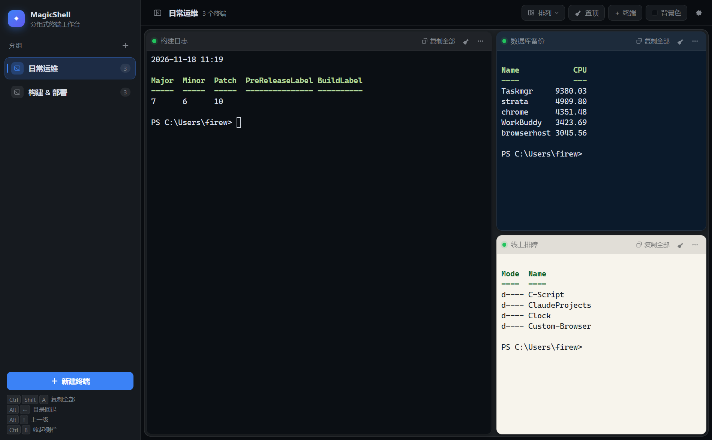
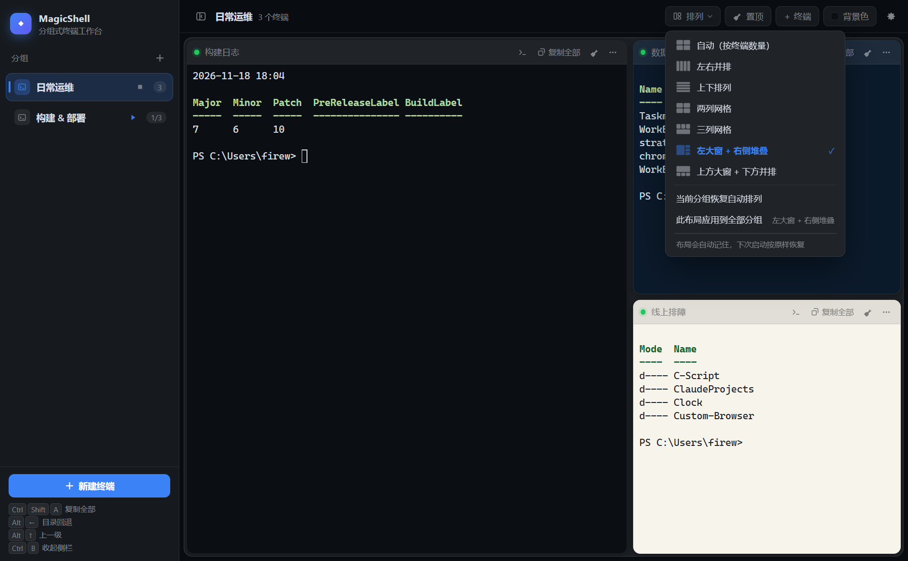
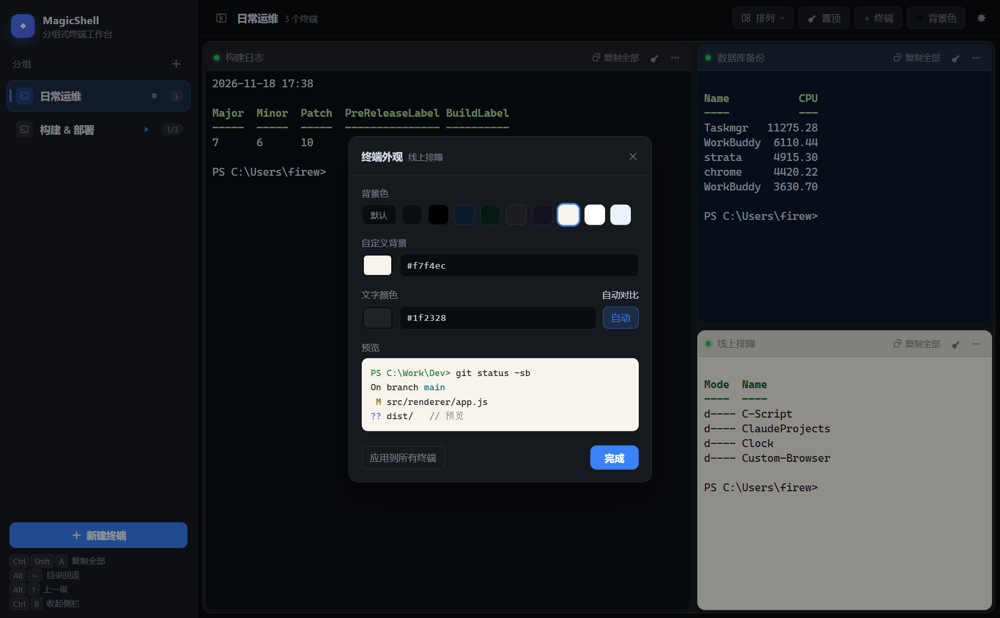
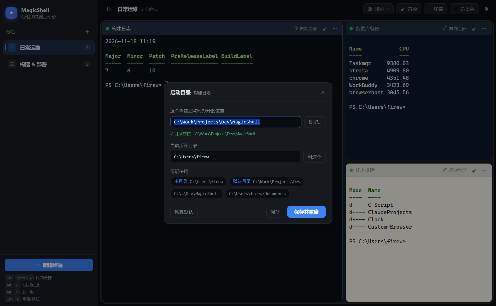
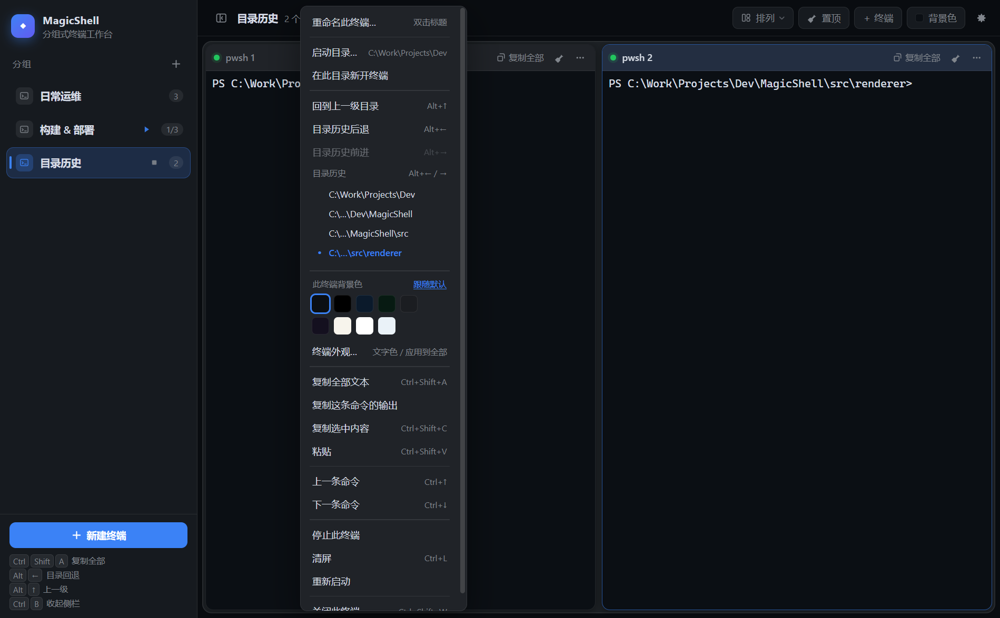
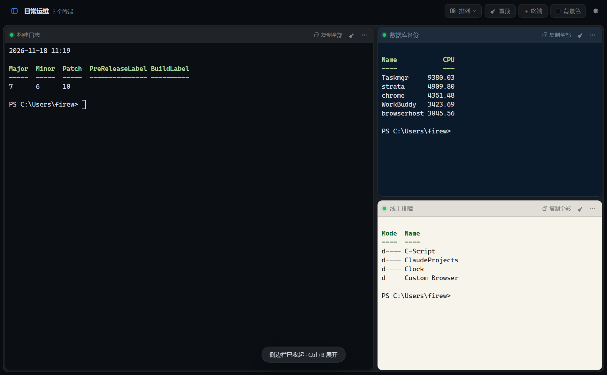
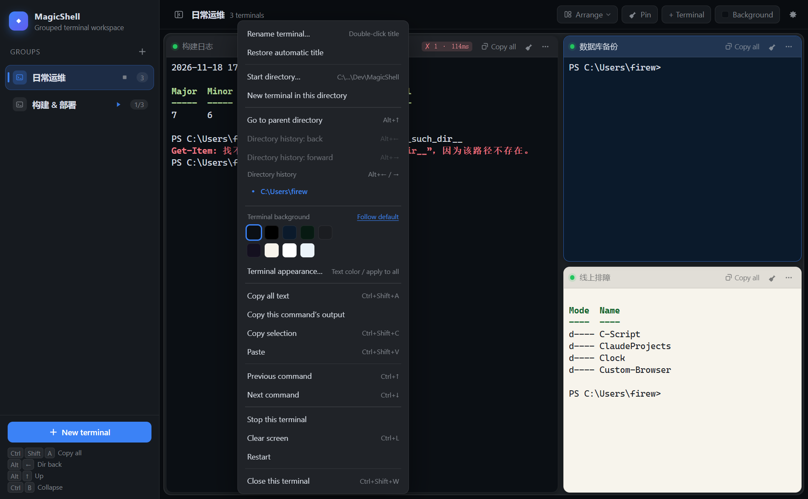
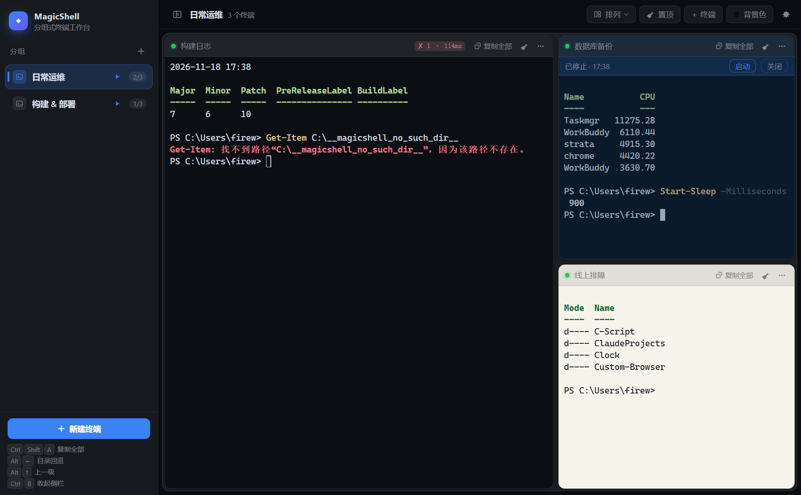
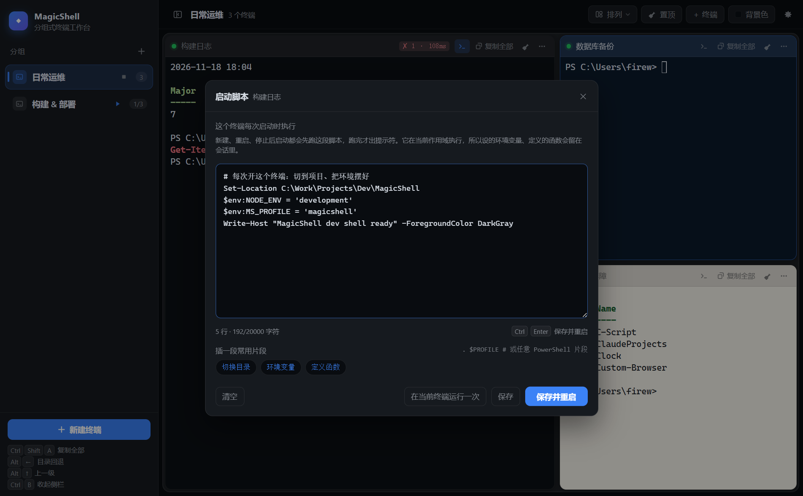

# MagicShell

A **grouped** terminal workbench for Windows. Under the hood it is a real PowerShell (ConPTY + `pwsh` / `powershell.exe` / `cmd.exe`), so commands, completion, colors and interactivity behave exactly like PowerShell — only the window management is rebuilt for people who keep a dozen sessions open.

[简体中文](README.md) | **English**



> **Don't want to set up a toolchain?** Download the portable build from [Releases](https://github.com/fire988/MagicShell/releases) (`MagicShell-*-win-x64.zip`), unzip it and double-click `MagicShell.exe`. No Node.js or build tools required.

*Screenshots show the Chinese UI — every string ships in both Chinese and English (see [UI language](#ui-language-chinese--english)).*

## Why another terminal

A native PowerShell window shows one session at a time, and you switch with Alt+Tab. Windows end up scattered, and changing the background color means changing the properties of the whole console.

MagicShell packs the sessions you use together into a **group**: terminals inside a group are laid out side by side, one click brings the whole group forward, and a pin keeps that group on top of everything else.

## What it adds

| Need | How it works |
| --- | --- |
| Change the background color | The **Background** button in the top right recolors the entire window; each terminal can also be **themed on its own**: right-click a terminal → Terminal appearance (or the `…` button in its title bar). Nine presets plus an arbitrary color picker, and the text color is auto-derived for contrast against the background. "Apply to all terminals" in that dialog repaints every terminal in every group and becomes the default for new ones. The whole UI (sidebar, borders, text) follows the dark/light switch, including the Windows title bar. |
| Each shell can have its own title | **Double-click a terminal's title bar** to rename it (`Enter` saves, `Esc` cancels, clearing restores the automatic title); the context menu also has "Rename this terminal". A custom title is never overwritten by a window title emitted by the shell, while automatic titles keep following the running command. Titles are saved with the group. |
| Each shell can have a default directory | Right-click a terminal (or `…`) → **Start directory…**: type a path, or click "Browse…" to pick a folder. The dialog also shows the terminal's **actual current directory** with a one-click "Use this". Saved with the group, so the next launch starts there; a global "Default start directory" in Settings covers all new terminals. Non-existent directories are rejected with a message instead of giving you a blank terminal. |
| Step back through previous `cd`s | Every terminal keeps its own **directory history**: `Alt+←` walks back one level at a time, `Alt+→` walks forward again, `Alt+↑` goes to the parent directory. The context menu lists the full history — click any entry to jump there. |
| Collapse, expand and resize the sidebar | The leftmost button in the top bar (or `Ctrl+B`) hides the group list so the workspace takes the full window; **drag the sidebar's right edge** to resize it (180–460 px, with the upper bound shrinking on narrow windows), double-click the edge to reset to 250 px. Width and collapsed state are remembered. |
| Groups — click one and all its shells show up | A group list on the left. Each group is a "stage" and its terminals are tiled on that stage. Click a group and the whole group appears at once; clicking any terminal inside it also brings the group to the front. |
| Free-form window placement | **Drag the title bar to move**, **drag any edge or corner to resize** (8 directions). Edges snap to each other, dragging outside the stage is clamped, and a minimum size stops you from squashing a terminal into a line. Positions are stored as ratios, so they scale with the window. Windows may overlap: **the one you click comes to the front**, and it is temporarily raised while you drag it. Clicking a title bar, toolbar or border also selects that window — and **keyboard focus (caret/input) follows along**, so you can type immediately without clicking into the terminal body. |
| Layout is remembered | Each group's position, size and arrangement are **written to disk the moment you let go**; window bounds, position and maximized state are saved too. The next launch restores exactly what you had (can be disabled in Settings). Config uses a single in-memory copy, atomic writes and a backup, so an interrupted write cannot lose your layout. |
| Copy all text | The "Copy all" button in each terminal's title bar, `Ctrl+Shift+A`, or the context menu. It copies the **entire scrollback buffer** (10,000 lines by default), not just the visible screen. The group context menu can copy every terminal in the group at once. |
| Pin a group with the title-bar pin | Every terminal's title bar has a 📌 that pins **the whole current group** above other windows; click again to unpin. The top toolbar has the same toggle, and pinned groups show a blue pin in the sidebar. Switching to a group that is not pinned automatically unpins. |
| UI in Chinese and English | **Language** in Settings: **Follow system** / 简体中文 / English. Switching takes effect **immediately, no restart** — menus, tooltips, context menus, shortcut hints, toasts, font names and auto-generated group names all follow; groups and terminals you renamed yourself stay as they are. English menus size themselves to their content instead of truncating. |
| Every command is a block: exit code, duration, navigation | Using PowerShell's prompt hook (`OSC 133`), each command records its **exit code** and **duration**. The right side of the title bar shows `✓ 717ms` / `✗ 1 · 0.11s` (failures always show; fast successes stay out of the way). `Ctrl+↑ / ↓` jumps between commands, and the context menu can **copy just this command's output** instead of the whole scrollback. Commands that take longer than 3 seconds raise a notification and flash the taskbar when the window is not in the foreground. |
| Stop a terminal, keep the window — start/stop a whole group | Any terminal can be stopped on its own: the process really exits and the memory is returned, while the window, position, title, colors and last chunk of output stay. Each group has a power button in the sidebar — "Stop group" while everything is running, "Start group" once something is stopped. The stopped state is persisted, so those groups are still stopped after a restart; typing into a stopped terminal starts it automatically. |
| A startup script per terminal | The `>_` button at the left of the title bar opens an editor: a few lines of PowerShell (or batch). New terminal, restart, and start-after-stop all run it **before the first prompt appears**. `Ctrl+Enter` saves and restarts, and "Run once in this terminal" lets you try it first. Terminals with a script get a highlighted button so you can see at a glance that something is attached. |

### Auto-arrange

The **Arrange** dropdown in the top toolbar offers 7 common layouts; picking one re-tiles the current group immediately. The last entry applies the current layout to every group at once.

A group you have dragged manually is marked "Custom" (the first entry draws a thumbnail of your actual placement). New terminals split the largest window in half instead of disturbing the arrangement you already made.

### Layout memory

- Dragging and resizing are written to disk on mouse-up — no waiting for exit; pending changes are also flushed when the window closes or the app goes to the background
- What is remembered: each terminal's position and size (stored as 0–1 ratios, so they still hold when the window changes size), whether a group uses a preset or a manual arrangement, the active group, and the window's bounds/size/maximized state
- Restored on launch, with a toast in the bottom right: "Restored last layout · N groups / M terminals"
- Config lives in `%APPDATA%\MagicShell\magicshell-config.json` (a `.bak.json` next to it holds the previous version; a corrupted main file falls back automatically)





### Start directory

- Every terminal can have its own start directory: right-click it (or `…`) → **Start directory…**
- The dialog accepts a typed path, a "Browse…" picker, and a "Recent" row at the bottom (home, the global default, and recently used paths) that fills the field in one click
- "Current directory" is **live**: PowerShell reports `$PWD` through OSC 7 on every prompt, so it follows every `cd`. Click "Use this" to freeze the current location as the next start directory
- Saved with the group, so the terminal comes up there after a restart; if it is already running, "Save and restart" reopens it in the new directory right away
- "Default start directory" in Settings is the fallback for all new terminals (empty means the user's home); a per-terminal setting wins over it
- The terminal menu also has "New terminal in this directory", starting from the current terminal's directory
- A missing directory blocks saving; if a configured directory is deleted later, launch falls back to the global default / home with a message instead of hanging on a blank terminal



### Directory history (step back through `cd`)

After `cd`-ing deep into a tree you do not have to type `..` all the way back:

| Key | Action |
| --- | --- |
| `Alt+←` | Go to the directory **before the last `cd`**, repeatedly |
| `Alt+→` | Walk forward again (like browser forward) |
| `Alt+↑` | Go to the parent directory (same as `cd ..`) |

- History is **per terminal** and follows focus: whichever terminal has focus steps back; when focus is not in a terminal, the selected terminal of the current group is used
- It records what PowerShell actually reports, so typed `cd`, Tab completion and directory changes made by scripts all count
- `cd`-ing somewhere new in the middle of the history discards the forward entries, just like a browser
- If the target directory has been deleted, you get "Could not switch" and the cursor rolls back instead of getting stuck
- History restarts from the new start directory after a terminal restart; it is memory-only and never written to the config file
- Right-click → **Directory history** lists the whole path, marks the current entry with ●, and jumps anywhere on click



### Sidebar width and collapse

- The leftmost button in the top bar, or `Ctrl+B`: collapse / expand the group list. Collapsed, the sidebar is zero-width and terminals re-tile to fill the window
- Hovering the right edge shows a vertical line — drag it to resize (180–460 px; on narrow windows the cap becomes 45% of the window width)
- Double-click the edge to reset to 250 px
- Terminals are not re-fitted on every frame while dragging (about 90 ms throttling); one precise fit happens on mouse-up, so dragging stays smooth
- Width and collapsed state go into the config and come back on the next launch



### UI language (Chinese / English)

- **Language** at the bottom of the Settings drawer: **Follow system** (default) / 简体中文 / English
- Switching applies **instantly** — no restart, no lost layout, no interruption to running terminals. The choice is persisted
- It is not just button labels: menu items, tooltips, context menus, shortcut hints, toasts, dialog titles, theme preset names and auto-generated group names (`分组 2` ↔ `Group 2`) all switch
- **Anything you renamed stays put**: manually renamed groups and custom terminal titles are left alone
- English menus size themselves to their content (rather than a fixed Chinese width), so you never see "Restore automatic tit…"
- Only the UI is translated — what runs inside the terminal (command output, PowerShell errors) naturally stays as it is
- "Follow system" uses the Windows display language: `zh-*` → Chinese, `en-*` → English, everything else falls back to English



### Command blocks: exit code, duration, navigation, notifications

Besides reporting the directory, PowerShell's prompt hook emits a series of `OSC 133` sequences (the same set Windows Terminal and VS Code use). MagicShell turns each command into a block:

| Capability | Details |
| --- | --- |
| Result badge | Right side of the title bar: a success over 300 ms shows `✓ 717ms`; a failure always shows `✗ 1 · 0.11s` (exit code + duration). Colors follow the light/dark theme. |
| Exit code | `$?` true → 0; otherwise `$LASTEXITCODE` (the real code from native commands like `git` and `npm`); a failing cmdlet is recorded as 1. |
| Jump between commands | `Ctrl+↑` goes to the previous command (the viewport aligns to its first line and flashes), `Ctrl+↓` moves toward the newest, and pressing again at the end returns to the bottom. Also in the context menu. |
| Copy one command's output | Right-click → "Copy this command's output": every line between this command finishing and the next one starting, **without the prompt**. For everything, use `Ctrl+Shift+A`. |
| Done notification | When a command that ran longer than 3 seconds finishes and the window is not in the foreground: a system notification plus a flashing taskbar button; the taskbar shows an indeterminate progress bar while it runs. Can be turned off in Settings. |

- PowerShell only (`pwsh` / `powershell.exe`). `cmd.exe` has no equivalent hook — commands still run, they just get no badges or jumps
- Blocks are memory-only and never written to config; a restarted terminal starts from scratch
- Stop-then-start is equivalent to a brand-new shell: directory history and command blocks restart, and the old output remains on screen only up to the moment you pressed Start
- It is display state only: nothing extra is injected into your command stream, so `Ctrl+C`, pipes and multi-line commands behave exactly as before


### Stopping and starting terminals (saving memory)

With many groups open, the memory hog is not the UI — it is each PowerShell behind it (measured at roughly **100 MB working set** and 34 MB private bytes per session). So a terminal can be "stopped": **the process dies, the window stays**.

- What stops is the process, not the window: position, title, colors and layout are untouched, and the last chunk of output stays on screen (you just cannot type into it)
- Three entry points: the `…` menu or right-click → "Stop this terminal"; group context menu → "Stop group"; and **the power button next to each group in the sidebar** (Stop group while all are running, Start group once something is stopped)
- The sidebar badge becomes `running/total` (e.g. `1/2`) and turns gray at `0/2`
- **Typing into a stopped terminal starts it** — that keystroke is forwarded, so you do not have to click a button first
- The stopped state is **persisted**: the groups you stopped are still stopped after a restart, no need to redo it every boot
- Starting again returns to **the directory it was in when stopped**, not the configured start directory
- The trade-off: stopping interrupts a running command and discards the half-typed line in PSReadLine — that is what "stop" means, so there is no confirmation, only a toast: "Stopped N terminals"
- Works the same for `cmd.exe` (it is purely process-level, unrelated to command blocks)



### Startup script (per terminal)

Each terminal can carry its own startup script for all the things you would otherwise type every single time: switch to the project directory, set environment variables, define a few helper functions.

- Entry point: the `>_` button at the left of the title bar (also in the `…` menu as "Startup script…"). When a script is set the button lights up in the accent color and its tooltip shows the line count
- The dialog has a monospace editor: `Tab` indents two spaces, `Ctrl+Enter` saves and restarts. Snippet buttons on the right insert common patterns written for the current shell (pwsh or cmd)
- Three actions: **Save** (takes effect on the next start), **Save and restart** (reopens immediately with the new script), and **Run once in this terminal** (feeds it to the live session without touching the startup config — good for trying before committing)
- Execution timing: a new terminal, `Restart`, and start-after-stop all run it **before the first prompt appears**, so a `Write-Host` in the script is the first line you see
- It runs **in the current scope** (dot-sourced for PowerShell): `$env:XXX` assignments and functions you define stay available in the session instead of vanishing when the script ends
- Nothing is echoed to the screen as if it had been typed, and nothing lands in the command history; a `cd` inside the script is picked up by OSC 7, so the title bar and the "Current directory" entry update immediately
- It is not stuffed into the command line (length limits, escaping hell). The script is written to `%APPDATA%\MagicShell\startup\<terminal id>.ps1` (`.cmd` for cmd, with `@echo off` added) and dot-sourced / `/K`-executed by the shell at startup. It is rewritten on demand every launch, after the whole directory has been wiped clean at startup
- Saved with the group, so it survives reloads and restarts; to remove it, clear the text and save
- Limit: 20,000 characters (the dialog shows a live line and character count)



## Everything else (identical to PowerShell)

- Real ConPTY pseudo-terminals running `pwsh` / `powershell.exe` / `cmd.exe` (selectable in Settings; PowerShell 7 is preferred automatically by default)
- Full ANSI / true color, correct CJK monospace rendering, mouse selection, wheel scrollback
- The working directory follows the shell: after `cd`, the menu and the start-directory dialog update immediately (reported by PowerShell over OSC 7)
- `Ctrl+C`, `Ctrl+V`, PSReadLine line editing and history completion all behave as usual
- GPU-accelerated rendering (WebGL, falling back to DOM rendering automatically), so heavy output stays smooth
- Group structure, terminal titles/colors/layout are remembered when you close the window and restored on the next launch (can be disabled in Settings)

## Shortcuts

| Shortcut | Action |
| --- | --- |
| `Ctrl+T` | New terminal in the current group |
| `Ctrl+Shift+T` | New group |
| `Ctrl+Shift+W` | Close the current terminal (closing the last one closes the group) |
| `Ctrl+Shift+A` | Copy all text of the current terminal |
| `Ctrl+Shift+C` / `Ctrl+Shift+V` | Copy selection / paste |
| `Ctrl+Shift+P` | Pin / unpin the current group |
| `` Ctrl+` `` / `Ctrl+1..9` | Cycle groups / jump to group N |
| `Ctrl+=` `Ctrl+-` `Ctrl+0` | Increase / decrease / reset font size |
| `Alt+←` / `Alt+→` | Directory history back / forward (one level at a time) |
| `Alt+↑` | Go to the parent directory |
| `Ctrl+↑` / `Ctrl+↓` | Jump to the previous / next command (command blocks) |
| `Ctrl+B` | Collapse / expand the group sidebar |
| `F12` | Developer tools |

Right-click in a terminal → Rename / Start directory / New terminal in this directory / Go to parent directory / Directory history (back, forward, list) / Background color (the menu stays open so you can try colors in a row) / Terminal appearance / Copy all / Paste / Clear / Restart / Close.

Right-click a group in the sidebar → Rename, pin, copy the whole group, close.

## Running

```bash
npm install        # skip if already installed
npm start
```

> If `ELECTRON_RUN_AS_NODE=1` has leaked into your environment (some IDEs do this), clear it first,
> otherwise Electron starts in Node mode:
> `env -u ELECTRON_RUN_AS_NODE npm start` (on Windows: `Remove-Item Env:ELECTRON_RUN_AS_NODE` in PowerShell).

## Packaging to an exe

`dist/` holds build output and is not committed (see `.gitignore`), so build your own:

```bash
npm run package     # assembles the Electron runtime + app code into dist/MagicShell
```

The result is `dist/MagicShell/`: double-click `MagicShell.exe` inside it, and the whole folder can be copied anywhere (no installer).

The electron-builder config is still there (`npm run dist`, producing a single portable exe).
Note that a local HTTP proxy makes electron-builder fail with 502 while downloading winCodeSign/NSIS resources,
which is why `npm run package` above is the recommended path. Also, if the "Spectre-mitigated libraries"
are not installed, pass `-c.npmRebuild=false` to skip rebuilding native modules (node-pty ships N-API
prebuilt binaries, so no rebuild is needed).

## Layout

```
src/main.js             main process: window, PTY sessions, config I/O, pinning
src/preload.js          the safe API exposed through contextBridge
src/shared/i18n.js      Chinese/English dictionaries + locale resolution (shared, UMD)
src/renderer/app.js     all front-end logic: groups, terminals, themes, shortcuts, menus
src/renderer/index.html markup
src/renderer/styles.css theme (colors are written into CSS variables from JS)
tools/                  development self-check scripts (CDP-driven, see below)
```

## Development self-checks

```bash
# 1. Start with a debugging port
./node_modules/electron/dist/electron.exe . --remote-debugging-port=9222
# 2. In another terminal
node tools/e2e.mjs 9222         # group tiling / copy all / pinning / background color / closing
node tools/e2e-input.mjs 9222   # real keyboard input / shortcuts / context menu / per-terminal colors
node tools/e2e-look.mjs 9222    # custom titles / per-terminal colors / apply to all / reload restore
node tools/e2e-layout.mjs 9222  # 7 layout presets / drag move / edge resize / bounds and min size / cycling colors
node tools/e2e-cwd.mjs 9222     # per-terminal start directory / global default / OSC 7 tracking / bad path fallback / dialog / persistence
node tools/e2e-hist.mjs 9222    # directory history: accumulation / Alt+←→↑ stepping / menu list / rollback / reset on restart
node tools/e2e-sidebar.mjs 9222 # sidebar: drag to resize / limits / double-click reset / collapse / Ctrl+B / remembered on reload
node tools/e2e-stack.mjs 9222   # window stacking: overlap hit-testing / title bar not covered by the canvas / activation / raise while dragging
node tools/e2e-focus.mjs 9222   # input focus: after clicking a title bar, resizing, menus or switching groups, the keyboard must land in that terminal
node tools/e2e-cmd.mjs 9222     # command blocks: exit codes / duration / badges / Ctrl+↑↓ / copy one output / notification rule / cmd fallback
node tools/e2e-pause.mjs 9222   # stop/start: processes really reclaimed / switching groups does not revive / group button / typing starts / persisted
node tools/e2e-script.mjs 9222  # startup script: runs before the prompt / no echo / dot-source scope / run once / clearing / cmd fallback
node tools/e2e-i18n.mjs 9222    # Chinese/English: no leftover Chinese in English mode / auto group names / user names untouched / persisted
node tools/check-i18n.mjs       # static check (no app needed): key parity between zh and en, and that referenced keys exist
node tools/e2e-persist.mjs 9222 stamp    # arrange a layout, persist it, record the expected values
#   then close the app, restart it with the same config directory:
node tools/e2e-persist.mjs 9222 verify   # verify positions / groups / window size came back intact
node tools/probe.mjs .tmp/a.png 9222     # dump state + screenshot
```

## Known limitations

- Windows only for now (ConPTY); supporting macOS/Linux is a matter of swapping the shell resolution in `node-pty`
- Child windows live inside the single application window rather than being separate OS windows (a multi-window version needs its own window manager and is not implemented)
- No alignment guides or magnetic grid — only edge snapping; no proportional scaling of a whole group
- Layouts are stored relative to the current stage, so moving to a screen with a very different resolution scales the absolute pixel sizes accordingly (nothing gets misplaced, but windows may end up smaller/larger)
- Live "current directory" tracking relies on PowerShell's prompt hook (OSC 7). `cmd.exe` has no such hook, so only a manually set start directory applies and the live location shows "shell has not reported yet"; if you redefine `prompt` in your profile the hook is overridden and it degrades the same way. Directory history depends on that tracking, so the hotkeys on `cmd.exe` only report "cannot track the directory"
- Directory stepping works by sending a `cd` into the terminal, so it first sends `Ctrl+C` to clear a half-typed command line; if a long task is running at that moment, that `Ctrl+C` will interrupt it
- The start directory only accepts existing local folders; relative paths are resolved against the user's home directory (so they do not follow the app's own cwd)
- Windows may overlap, so a terminal **completely covered** by another can only be reached by dragging the top one away (the sidebar lists groups only — there is no per-group terminal list yet)
- Only Chinese and English UI strings exist; adding a language means adding a dictionary with the same keys in `src/shared/i18n.js` (`tools/check-i18n.mjs` reports what is missing)
- There is an edge case in command-block exit codes: running **the same native command twice with the same exit code** records the second one as 1 (the code is judged stale by "did `$LASTEXITCODE` change", and this case cannot be told apart). Success/failure is still correct — only the number is imprecise
- If you redefine `prompt` in your PowerShell profile, the hook is overridden — live directory and command blocks both stop working (falling back to a manual directory and no badges)
- No custom application icon yet (the packaged build uses the default Electron icon)

## License

[MIT](LICENSE) — free to use, modify, sell and redistribute, with **one condition: keep the copyright and license notice** (ship `LICENSE.txt` alongside binaries; the packaging script already does this).
