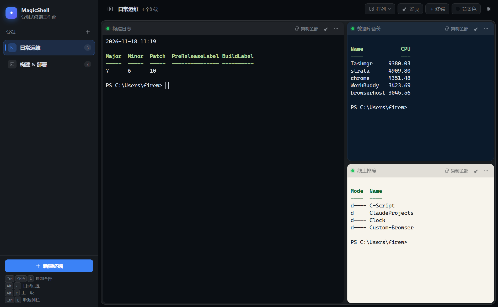
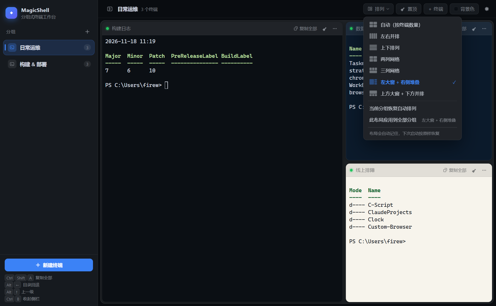
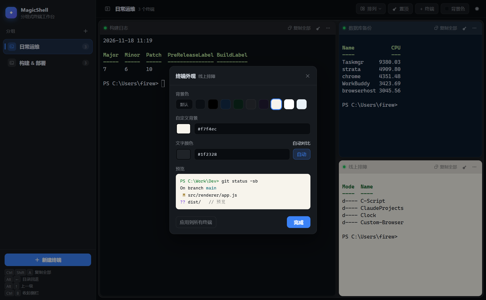
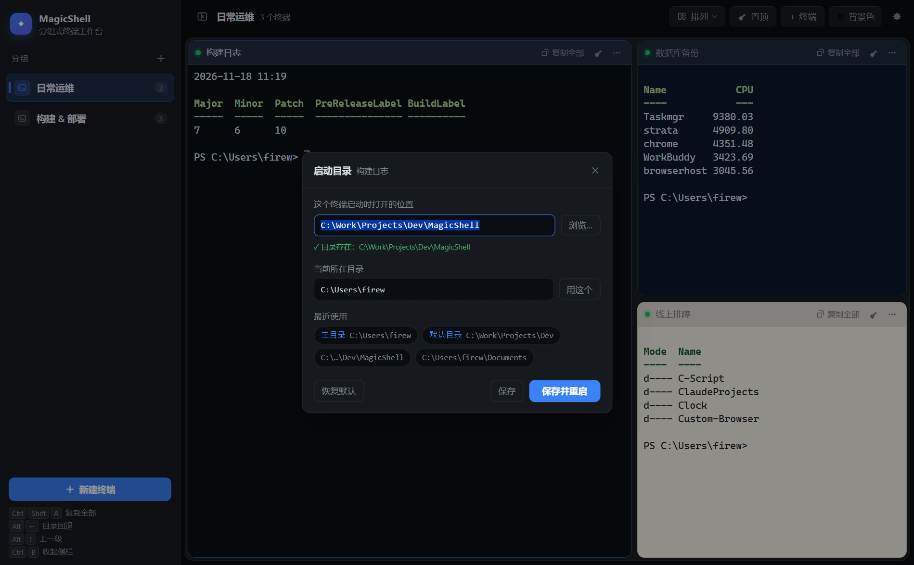
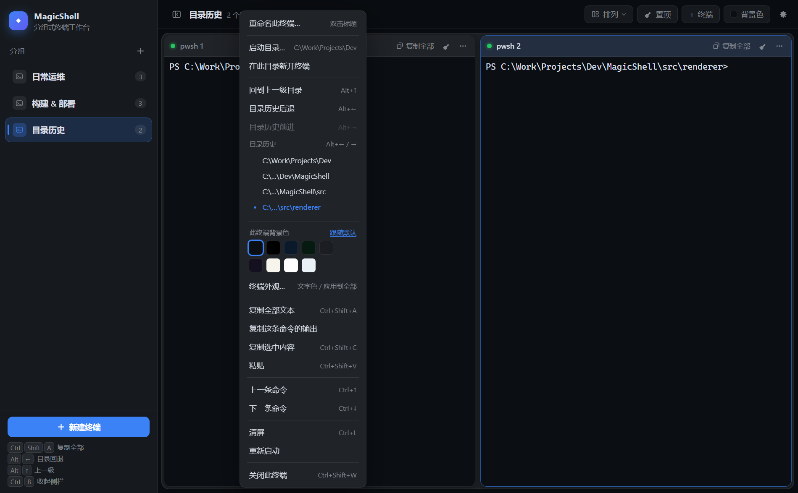
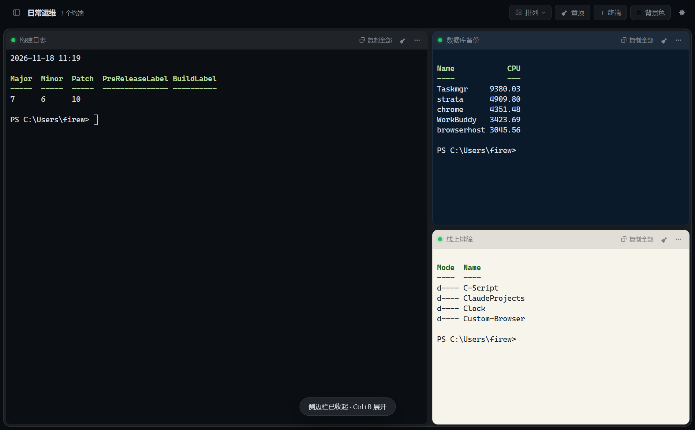
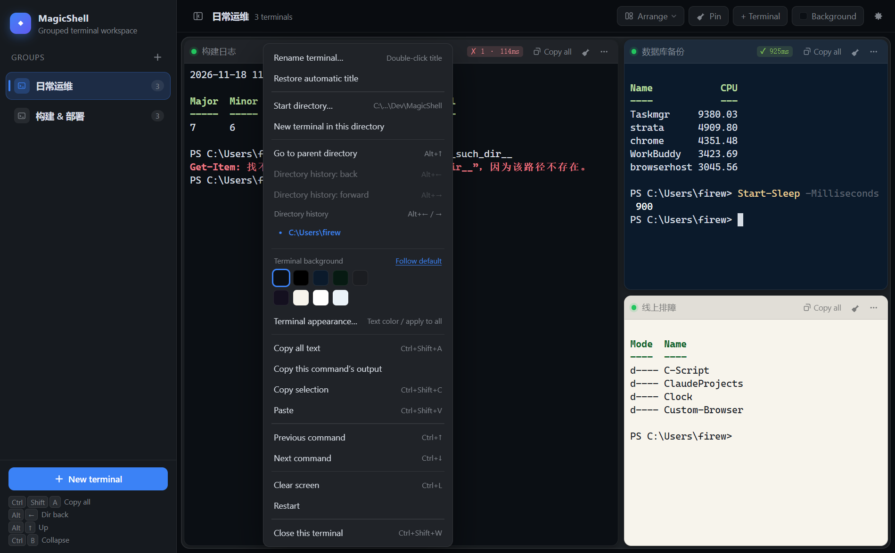

# MagicShell

一个「分组式」Windows 终端工作台：底层就是真的 PowerShell（ConPTY + pwsh/powershell/cmd），
所以命令、补全、颜色、交互与 PowerShell 完全一致，只是把窗口管理换成了更适合多任务的方式。



## 为什么要自己写

原生 PowerShell 窗口一次只能看一个会话，切换靠 Alt+Tab；窗口位置散乱、改背景色只能改整个控制台属性。
MagicShell 把你常用的几个会话「打包成一组」，一组内的终端并排铺开、点一下整组一起亮相，
再用图钉把这一组钉在最前面。

## 增强点

| 需求 | 实现 |
| --- | --- |
| 背景色可以更改 | 右上角「背景色」改整个窗口；终端还能**单独配色**：右键终端 → 终端外观（或标题栏 `…`），9 套预设 + 任意取色，文字色可自动按背景亮度取高对比色。弹层里的「应用到所有终端」一次刷到所有分组的所有终端，并作为新终端的默认。整窗 UI（侧栏、边框、文字）跟着深浅自动换配色，Windows 标题栏也同步。 |
| 每个 shell 可以有自己的标题 | **双击终端标题栏**直接改名字（`Enter` 保存、`Esc` 取消、清空则恢复自动标题）；右键菜单也有「重命名此终端」。自定义标题不会被 shell 自己发的窗口标题覆盖，自动标题则照旧跟随当前命令。标题会随分组一起保存。 |
| 每个 shell 可以指定默认路径 | 终端右键/`…` → **启动目录…**：输入框直接写、或点「浏览…」选文件夹，弹层里还能看到该终端**当前真实所在目录**并一键「用这个」。保存后随分组一起记住，下次启动直接在该目录里起来；设置里可配「默认启动目录」给所有新终端用。目录不存在会拦住并提示，不会给你一个空终端。 |
| 多次 cd 之后能逐级回退 | 每个终端自己记一条**目录历史**：`Alt+←` 一级级退回去、`Alt+→` 再走回来、`Alt+↑` 回到上一级目录。菜单里还能看到完整历史、点哪条跳哪条。 |
| 侧边栏可以收起/展开、能拖宽 | 顶栏最左边一个按钮（或 `Ctrl+B`）收起左侧分组栏，工作区立刻占满；**拖侧边栏右边缘**可以改宽度（180~460px，窗口很窄时上限自动收），双击边缘复位成 250px。宽度和收起状态都会记住。 |
| 分组，点其中一个则该组 shell 全部显示 | 左侧分组栏。每个分组是一块「舞台」，组内终端平铺在舞台上。点分组 → 整组终端同时呈现；点组内任一终端也会把该组切到前台。 |
| 子窗口可自由摆放 | **拖标题栏移动**、**拖四条边/四个角缩放**（8 个方向），边缘互相吸附、拖出舞台会被夹住，缩放有最小尺寸保护，避免把终端压成一条线。位置按比例保存，窗口放大缩小整体等比跟随。窗口之间可以重叠：**点哪个哪个浮到最前**，拖动时临时置顶，松手回到普通层。点标题栏、工具条、边框都等于选中这个窗口，**键盘焦点（光标/输入）同时跟着过去**，点完可以直接打字，不用再去点一下终端正文。 |
| 布局会被记住 | 每个分组的位置、大小、用的是哪套排列，**松手即落盘**；窗口尺寸、位置、是否最大化也一起记住。下次启动自动还原到上次的样子（设置里可关）。配置采用「内存单份 + 原子写入 + 备份」，写到一半被打断也不会丢布局。 |
| 复制全部文本 | 每个终端标题栏的「复制全部」按钮、`Ctrl+Shift+A`、右键菜单，三种方式。取的是**整段回滚缓冲**（默认 1 万行），不是只有可见区域。还能在分组右键菜单里一次复制整组所有终端文本。 |
| 标题栏图钉，点任意窗口的图钉把当前组置顶 | 每个终端标题栏都有 📌，点它就把**当前分组**（整个窗口）钉在其它窗口之上；再点取消。顶部工具栏有同样的「置顶」按钮，侧栏被钉住的分组会显示蓝色图钉。切到未置顶的分组时会自动取消置顶。 |
| 界面支持中英双语 | 设置里「语言」可选**跟随系统** / 简体中文 / English。切完**立刻生效，不用重启**，连自动命名的分组、菜单、提示气泡、字体名、快捷键说明都会跟着换；你自己改过名字的分组和终端标题不动。英文模式下菜单宽度自适应，不会把字截掉。 |
| 每条命令都有「块」：退出码、耗时、可跳转 | 借助 PowerShell 的 prompt 钩子（OSC 133），每条命令都会记下**退出码**和**耗时**。标题栏右侧显示 `✓ 717ms` / `✗ 1 · 0.11s`（失败的总是显示，成功的短命令不占地方）。`Ctrl+↑ / ↓` 在命令之间跳，右键还能「复制这条命令的输出」——只复制这一条的输出，不是整段回滚缓冲。超过 3 秒的命令跑完时，如果窗口不在前台会弹通知并闪任务栏。 |

### 自动排列

顶部工具栏「排列」下拉里有 7 种常见布局，点一下立即重排当前分组；最后一项可以把当前布局一次套到所有分组。
手动拖过的分组会标记为「自定义」（下拉首项会画出你当前真实摆位的缩略图），之后新开终端会把最大的那块窗劈成两半腾位置，不会打乱你已经摆好的位置。

### 布局记忆

- 拖动/缩放一松手就写入配置，不等退出；关窗、切到后台时也会把待写的改动立刻落盘
- 记住的东西：每个终端的位置与大小（按 0~1 比例存，换窗口尺寸也等比成立）、分组用的是预设还是手动摆的、当前激活的分组、窗口位置/尺寸/最大化状态
- 启动时按这些值还原，并在右下角提示「已恢复上次布局 · N 个分组 / M 个终端」
- 配置写在 `%APPDATA%\MagicShell\magicshell-config.json`（同目录 `.bak.json` 是上一版备份，主文件损坏会自动回退）





### 启动目录

- 每个终端可以有自己的「启动目录」：右键终端（或标题栏 `…`）→ **启动目录…**
- 弹层里能直接输入、点「浏览…」选目录，底部「最近使用」放着主目录、全局默认目录和最近用过的几个路径，点一下就填
- 「当前所在目录」是**实时**的：PowerShell 每次显示提示符时都会通过 OSC 7 报告 `$PWD`，`cd` 到哪这里就显示哪，点「用这个」即可把当前位置固定成下次的启动目录
- 保存后随分组一起落盘，重启应用后终端直接在该目录起来；如果终端正在运行，点「保存并重启」立刻换目录重开
- 设置里的「默认启动目录」是所有新终端的默认值，留空即用户主目录；单终端设置优先于它
- 终端菜单里还有「在此目录新开终端」：以当前终端所在目录为起点再开一个
- 目录不存在时保存会被拦住；如果配置过的目录后来被删了，启动时会退到全局默认/主目录并弹提示，不会卡在空白终端



### 目录历史（cd 逐级回退）

`cd` 进到很深的目录，想退回去不用一路敲 `..`：

| 按键 | 作用 |
| --- | --- |
| `Alt+←` | 退到**上一次 cd 之前**的目录，可以一直往前退 |
| `Alt+→` | 退多了就往回走（和浏览器前进一样） |
| `Alt+↑` | 回到上一级目录（等于 `cd ..`） |

- 历史是**每个终端各自一份**，按焦点走：焦点在哪个终端就回退哪个；焦点不在终端上时作用于当前分组里被选中的那个
- 记录的是 PowerShell 真实报告的目录，所以手敲 `cd`、按 Tab 补全、跑脚本换了目录都算数
- 在历史中间又 `cd` 去了新地方，后面的「前进」记录会作废（和浏览器一致）
- 目标目录要是被删了，会提示「没能切过去」并把指针退回去，不会卡在错误的状态
- 终端重启后历史从新的启动目录重新开始；历史只放内存，不写进配置文件
- 右键菜单 → **目录历史** 里能直接看到这一路走过的目录，当前那条标着 ●，点任意一条直接切过去



### 侧边栏收起与宽度

- 顶栏最左边的按钮，或 `Ctrl+B`：收起 / 展开左侧分组栏；收起后侧栏宽度归零，终端立即重排占满整个窗口
- 鼠标移到侧栏右边缘会出现一条竖线，按住拖动即可改宽度（180~460px；窗口本身很窄时上限会按窗口宽度的 45% 自动收）
- 双击这条边缘复位成 250px
- 拖动过程中不会每帧重排终端（约 90ms 节流），松手后再精确 fit 一次，避免拖起来一卡一卡
- 宽度与收起状态写进配置，下次启动原样恢复



### 界面语言（中 / 英）

- 设置抽屉最下面的「语言」：**跟随系统**（默认）/ 简体中文 / English
- 切换**立即生效**，不重启、不丢布局、不打断正在跑的终端；语言写进配置，下次启动照样用这个
- 换掉的不只是按钮文字：菜单项、悬停提示、右键菜单、快捷键说明、提示气泡、对话框标题、配色预设名、自动命名的分组名（`分组 2` ↔ `Group 2`）都跟着走
- **你自己改过名字的东西不动**：手动重命名过的分组、自定义的终端标题都保持原样
- 英文下菜单宽度会按内容自适应（不是固定中文宽度），不会出现「Restore automatic tit…」这种截断
- 只有界面文案会翻译，终端里跑的东西（命令输出、PowerShell 报错）当然还是原来的语言
- 跟随系统时按 Windows 的显示语言判断：`zh-*` 走中文，`en-*` 走英文，其它语言先落回英文



### 命令块：退出码、耗时、跳转、跑完提醒

PowerShell 的 prompt 钩子除了报目录，还会发一串 `OSC 133` 序列（Windows Terminal / VS Code 用的同一套），
MagicShell 拿它把每条命令收成一个「块」：

| 能力 | 说明 |
| --- | --- |
| 结果徽标 | 标题栏右侧：成功且超过 300ms 显示 `✓ 717ms`，失败一律显示 `✗ 1 · 0.11s`（退出码 + 耗时）。颜色自动跟随深浅主题。 |
| 退出码 | `$?` 为真记 0；为假时用 `$LASTEXITCODE`（`git`、`npm` 这些原生命令的真实退出码），cmdlet 报错记 1。 |
| 跳命令 | `Ctrl+↑` 跳到上一条命令（视口顶对齐那一行并闪一下），`Ctrl+↓` 往最新走，到底再按就回底部。右键菜单里也有。 |
| 复制单条输出 | 右键 →「复制这条命令的输出」：取这条命令结束到下一条命令之间的所有行，**不含提示符**。想复制整段还是 `Ctrl+Shift+A`。 |
| 跑完提醒 | 超过 3 秒的命令结束时，若窗口不在前台：系统通知 + 任务栏闪烁；跑的过程中任务栏显示不确定进度条。可在设置里关掉。 |

- 只对 PowerShell 生效（`pwsh` / `powershell.exe`）。`cmd.exe` 没有对等钩子，命令照跑，只是不会有徽标和跳转
- 命令块只放内存，不写配置；终端重启后从头记
- 状态只影响界面：不存在额外注入到你的命令流里的东西，`Ctrl+C`、管道、多行命令的行为都不变


## 其它能力（和 PowerShell 一致的部分）

- 真实 ConPTY 伪终端，跑的是 `pwsh` / `powershell.exe` / `cmd.exe`（设置里可选，默认自动优先 PowerShell 7）
- 完整 ANSI / 真彩色、中文等宽显示、鼠标选择、滚轮回滚
- 工作目录跟着 shell 走：`cd` 之后菜单与「启动目录」弹层里的当前位置即时更新（PowerShell 通过 OSC 7 报告）
- `Ctrl+C` 中断、`Ctrl+V` 粘贴、PSReadLine 的行编辑与历史补全全部照旧
- GPU 加速渲染（WebGL，失败自动退回 DOM 渲染），大量输出不卡
- 关闭窗口后自动记住分组结构、终端标题/配色/布局，下次启动还原（可在设置里关掉）

## 快捷键

| 快捷键 | 作用 |
| --- | --- |
| `Ctrl+T` | 当前分组新开终端 |
| `Ctrl+Shift+T` | 新建分组 |
| `Ctrl+Shift+W` | 关闭当前终端（关掉最后一个则分组一起关闭） |
| `Ctrl+Shift+A` | 复制当前终端全部文本 |
| `Ctrl+Shift+C` / `Ctrl+Shift+V` | 复制选中 / 粘贴 |
| `Ctrl+Shift+P` | 当前分组置顶 / 取消置顶 |
| `` Ctrl+` `` / `Ctrl+1..9` | 切换分组 / 跳到第 N 组 |
| `Ctrl+=` `Ctrl+-` `Ctrl+0` | 放大 / 缩小 / 重置字号 |
| `Alt+←` / `Alt+→` | 目录历史回退 / 前进（逐级） |
| `Alt+↑` | 回到上一级目录 |
| `Ctrl+↑` / `Ctrl+↓` | 跳到上一条 / 下一条命令（命令块） |
| `Ctrl+B` | 收起 / 展开左侧分组栏 |
| `F12` | 开发者工具 |

终端里右键 → 重命名 / 启动目录 / 在此目录新开终端 / 回到上一级目录 / 目录历史（后退、前进、列表） / 背景色（选完不关菜单，可以连着试色）/ 终端外观 / 复制全部 / 粘贴 / 清屏 / 重启 / 关闭；
侧栏分组右键 → 重命名、置顶、复制整组、关闭。

## 运行

```bash
npm install        # 已装好则跳过
npm start
```

> 若终端里 `ELECTRON_RUN_AS_NODE=1` 被写进了环境变量（某些 IDE 会这样），
> 需要先清掉它再启动，否则 Electron 会以 Node 模式运行：
> `env -u ELECTRON_RUN_AS_NODE npm start`（Windows 下可在 PowerShell 里 `Remove-Item Env:ELECTRON_RUN_AS_NODE`）。

## 打包成 exe

已经打好一份免安装版在 `dist/MagicShell/`，双击里面的 `MagicShell.exe` 即可运行（整个文件夹可以拷到任意位置）。

重新打包：

```bash
npm run package     # 直接把 Electron 运行时 + 应用代码组装到 dist/MagicShell
```

也保留了 electron-builder 配置（`npm run dist`，出单文件 portable exe）。
注意：本机网络代理会让 electron-builder 下载 winCodeSign/NSIS 资源时返回 502，
所以默认推荐上面的 `npm run package`。另外若本机没装「Spectre 缓解库」，
需要带 `-c.npmRebuild=false` 跳过原生模块重编译（node-pty 自带 N-API 预编译产物，无需重编）。

## 结构

```
src/main.js             主进程：窗口、PTY 会话管理、配置读写、置顶
src/preload.js          contextBridge 暴露的安全接口
src/shared/i18n.js       中英词典 + 语言解析（主进程与渲染层共用一份，UMD）
src/renderer/app.js     分组/终端/主题/快捷键/菜单全部前端逻辑
src/renderer/index.html 结构
src/renderer/styles.css 主题（颜色由 JS 写入 CSS 变量）
tools/                  开发期自检脚本（CDP 驱动，见下）
```

## 开发期自检

```bash
# 1. 带调试端口启动
./node_modules/electron/dist/electron.exe . --remote-debugging-port=9222
# 2. 另开终端
node tools/e2e.mjs 9222         # 分组平铺/复制全部/置顶/背景色/关闭
node tools/e2e-input.mjs 9222   # 真实键盘输入/快捷键/右键菜单/单终端配色
node tools/e2e-look.mjs 9222    # 自定义标题/单终端配色/应用到全部/重载恢复
node tools/e2e-layout.mjs 9222  # 7 种排列预设/拖动移动/拖边缩放/边界与最小尺寸/菜单连续换色
node tools/e2e-cwd.mjs 9222     # 单终端启动目录/全局默认/OSC 7 目录跟踪/坏目录回退/对话框/持久化
node tools/e2e-hist.mjs 9222    # 目录历史：cd 累积 / Alt+←→↑ 逐级回退 / 菜单列表 / 失败回滚 / 重启清空
node tools/e2e-sidebar.mjs 9222 # 侧边栏：拖动改宽 / 上下限 / 双击复位 / 收起展开 / Ctrl+B / 重载记忆
node tools/e2e-stack.mjs 9222   # 窗口层叠：重叠区命中 / 标题栏不被画布盖住 / 激活置顶 / 拖动置顶
node tools/e2e-focus.mjs 9222   # 输入焦点：点标题栏/拖边/菜单/侧栏切换后键盘焦点都要落在这个终端
node tools/e2e-cmd.mjs 9222     # 命令块：退出码/耗时/徽标/Ctrl+↑↓ 跳转/复制单条输出/通知判定/cmd 降级
node tools/e2e-i18n.mjs 9222    # 中英切换：英文模式界面零残留中文 / 自动分组跟随 / 用户命名不动 / 语言落盘
node tools/check-i18n.mjs       # 静态校验（不用起应用）：中英 key 是否对齐、代码引用的 key 是否存在
node tools/e2e-persist.mjs 9222 stamp    # 摆好布局并落盘，记录期望值
#   关掉应用、用同一配置目录重启后：
node tools/e2e-persist.mjs 9222 verify   # 校验重启后位置/分组/窗口尺寸是否原样恢复
node tools/probe.mjs .tmp/a.png 9222     # 抓状态 + 截图
```

## 已知限制

- 目前只针对 Windows（ConPTY）；代码层面换 `node-pty` 的 shell 解析即可支持 macOS/Linux
- 子窗口在同一个应用窗口内摆放，不是多个独立系统窗口（多窗口版本需要另写窗口管理，暂未做）
- 没有对齐辅助线/磁性网格，只有边缘吸附；也不支持整组等比缩放
- 布局是按"当前舞台比例"存的，换到分辨率差异极大的屏幕时，各窗口的绝对像素会跟着缩放（不会错位，但可能偏小/偏大）
- 「当前所在目录」的实时跟踪靠 PowerShell 的 prompt 钩子（OSC 7）。用 `cmd.exe` 时没有这个钩子，只能用手动指定的启动目录，实时位置显示为「shell 还没报告」；如果你自己在 profile 里重定义了 `prompt`，钩子会被覆盖，同样退化成手动指定。目录历史依赖这条跟踪，所以在 `cmd.exe` 下按热键只会提示「跟踪不到目录」
- 目录回退是靠「往终端里送一条 `cd`」实现的，所以按热键前会先发一次 `Ctrl+C` 清掉敲了一半的命令；如果这时终端里正在跑长任务，会被这条 `Ctrl+C` 打断
- 启动目录只接受本机存在的文件夹；相对路径按用户主目录展开（避免跟着应用自己的 cwd 跑）
- 窗口允许互相重叠；如果一个终端被别的终端**完全盖住**，只能拖开上面那个才能看到它（侧栏目前只列分组，还没有组内终端列表）
- 界面目前只有中文、英文两套文案；再加语言要在 `src/shared/i18n.js` 里补一份同 key 的字典（`tools/check-i18n.mjs` 会告诉你缺哪几条）
- 命令块的退出码有个边角情况：连续两次跑**同一条原生命令且退出码相同**时，第二次会被记成 1（用"$LASTEXITCODE 有没有变化"来判断它是不是陈旧值，这一种认不出来）。状态是成功还是失败不会错，只是数字不够精确
- 如果你在 PowerShell profile 里自己重定义了 `prompt`，钩子会被覆盖 —— 实时目录、命令块都会一起失效（退化成手动指定目录 + 没有徽标）
- 还没做自定义应用图标（打包后是 Electron 默认图标）
